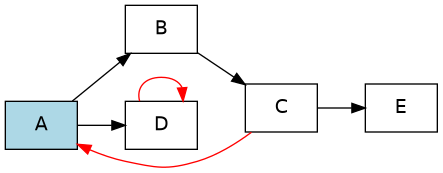
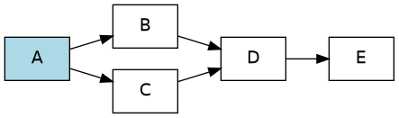
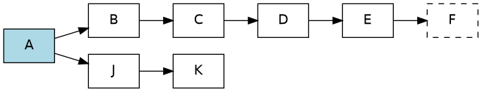
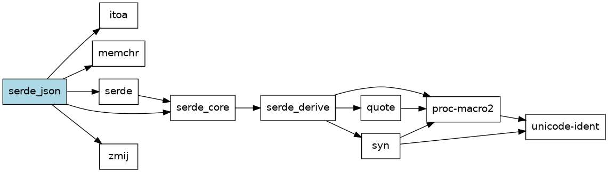
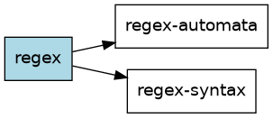
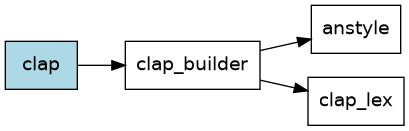

# Граф зависимостей пакетов Cargo

Практическая работа №2 по дисциплине «Конфигурационное управление»,
вариант 16. Выполнил: Клименко Максим.

## Общее описание

CLI-инструмент для визуализации графа зависимостей пакетов Rust
(Cargo). Готовые менеджеры пакетов и библиотеки для получения
зависимостей не используются, только стандартная библиотека Python.

Готовы этапы:

1. **Конфигурация** - XML-файл, проверка параметров, вывод
   в формате `ключ=значение`.
2. **Сбор данных** - прямые зависимости крейта с crates.io.
3. **Граф** - транзитивные зависимости обходом DFS без рекурсии,
   предел глубины, циклы, тестовые репозитории.
4. **Порядок загрузки** - топологическая сортировка и сравнение
   с реальным cargo.
5. **Визуализация** - текст на языке Graphviz DOT, картинка PNG,
   ASCII-дерево, сравнение с `cargo tree`.

Все пять этапов готовы, каждый оформлен отдельным коммитом.
Проект лежит в папке `pr2/` репозитория практических работ,
все команды ниже выполняются из нее (`cd pr2`).

## Требования

- Python 3.8 или новее, только стандартная библиотека
  (`urllib`, `json`, `xml.etree`, `argparse`);
- для картинки - Graphviz (программа `dot`): в Ubuntu
  `sudo apt install graphviz`, в Windows установщик с
  graphviz.org (галочка «Add Graphviz to the system PATH»).
  Без Graphviz все работает, кроме сохранения PNG;
- доступ к https://crates.io для реальных крейтов.

## Запуск

```sh
./run.sh CONFIG [--show params|deps|graph|order|dot]
            [--image PATH] [--view]
```

| Аргумент          | Описание                                         |
|-------------------|--------------------------------------------------|
| `CONFIG`          | путь к XML-файлу конфигурации                    |
| `--show params`   | напечатать параметры `ключ=значение` (этап 1)    |
| `--show deps`     | напечатать прямые зависимости (этап 2)           |
| `--show graph`    | граф зависимостей и циклы (этап 3)               |
| `--show order`    | порядок загрузки зависимостей (этап 4)           |
| `--show dot`      | DOT, картинка и ASCII-дерево (этап 5, по умолч.) |
| `--image PATH`    | куда сохранить PNG, по умолчанию `out/<пакет>.png` |
| `--view`          | открыть сохраненную картинку                     |
| `-h`, `--help`    | справка по аргументам                            |

`run.sh` можно запускать из любой папки. Относительный путь
к конфигу считается от текущей папки, а путь к тестовому графу
внутри конфига - от папки самого конфига. Без `run.sh` то же
самое делает `python3 -m src.main` из папки проекта.

Скрипт сам выбирает интерпретатор: `python3`, если он реально
запускается (`python3 -c ""`), иначе `python` (если это Python 3),
иначе `py -3`.

## Запуск на Windows

Нужен Python 3 с python.org (галочка «Add python.exe to PATH»).

- **Git Bash**: команды те же, что в Linux:
  `./run.sh configs/test_cycle.xml`. В Windows `python3` часто
  оказывается заглушкой Microsoft Store, которая не запускается,
  поэтому `run.sh` проверяет ее и переходит на `python` или `py -3`.
- **cmd или PowerShell**: `run.bat configs\test_cycle.xml`
  (в PowerShell `.\run.bat ...`). `run.bat` включает UTF-8
  (`chcp 65001`, `PYTHONUTF8=1`) и запускает `py -3` или `python`.
- **Тесты**: `python -m unittest discover tests` (или `py -3 -m ...`).

Пути в коде собираются только через `os.path` и `pathlib`, Unix-only
вызовов нет. Если Graphviz не установлен, программа печатает
текст DOT и сообщение `картинка не создана: программа dot
(Graphviz) не найдена в PATH`, но не падает. Текст DOT можно
вставить в онлайн-редактор https://dreampuf.github.io/GraphvizOnline
и посмотреть картинку там. ASCII-дерево состоит только из символов
ASCII, поэтому одинаково выводится в любой консоли.

## Конфигурация

```xml
<config>
    <package>serde_json</package>
    <repository>https://crates.io/api/v1</repository>
    <test_mode>false</test_mode>
    <ascii_tree>true</ascii_tree>
    <max_depth>3</max_depth>
</config>
```

| Параметр     | Описание                                             |
|--------------|------------------------------------------------------|
| `package`    | имя анализируемого пакета                            |
| `repository` | URL API crates.io или путь к файлу тестового графа   |
| `test_mode`  | `true` - работа с тестовым файлом, `false` - с сетью |
| `ascii_tree` | `true` - печатать зависимости ASCII-деревом          |
| `max_depth`  | максимальная глубина анализа, целое число от 1       |

Все параметры обязательны. Ошибки:

| Ситуация                              | Сообщение                          |
|---------------------------------------|------------------------------------|
| нет файла                             | `файл конфигурации не найден`      |
| битый XML                             | `неверный формат XML: ...`         |
| корень не `<config>`                  | `корневой элемент должен быть ...` |
| неизвестный или повторный параметр    | `неизвестный параметр: <color>`    |
| параметр пропущен                     | `не задан параметр <test_mode>`    |
| пустое или неверное имя пакета        | `package: ...`                     |
| пустой адрес, не http(s), нет файла   | `repository: ...`                  |
| режим не `true`/`false`               | `test_mode: ...`, `ascii_tree: ...`|
| глубина не число или меньше 1         | `max_depth: ...`                   |

Имя пакета проверяется по режиму: для crates.io - латиница, цифры,
`-` и `_`; для тестового графа - большие латинские буквы.

Примеры ошибочных конфигов лежат в `configs/bad/`, все сразу
запускает `scripts/stage1_errors.sh`.

## Источник данных: crates.io API

Для каждого крейта делаются два запроса (заголовок `User-Agent`
обязателен, без него crates.io отвечает 403):

1. `GET {repository}/crates/<имя>` - поле `max_stable_version`,
   последняя стабильная версия (если ее нет, `newest_version`);
2. `GET {repository}/crates/<имя>/<версия>/dependencies` - список
   зависимостей этой версии.

Из списка берутся только записи с `kind=normal` и `optional=false`.
Dev-зависимости (`kind=dev`) нужны только для тестов самого крейта,
build-зависимости (`kind=build`) - только для `build.rs`, а
необязательные включаются фичами, поэтому все они пропускаются.

Почему API, а не sparse index `index.crates.io`: API отдает обычный
JSON с последней версией в одном поле, а в индексе каждая версия
лежит отдельной строкой JSON Lines и последнюю стабильную пришлось
бы выбирать самому, сравнивая версии semver. С API кода меньше,
а данные те же. Минус API - ограничение частоты запросов (не чаще
1 запроса в секунду для обходчиков), так что большие графы лучше
строить с небольшой глубиной.

Ошибки сети и API (`не найдено`, `HTTP 500`, `нет связи`,
`ответ не JSON`) выводятся как `ошибка репозитория: ...`.

## Построение графа (этап 3)

Граф строится функцией `build_graph` (`src/graph.py`) обходом
в глубину **без рекурсии**: вместо стека вызовов используется список
`stack` с парами `(пакет, глубина)`.

1. Из стека берется пакет. Если он уже встречался на такой же или
   меньшей глубине, он пропускается. Так обрабатываются ромбы
   (общая зависимость запрашивается один раз) и циклы (обход
   не ходит по кругу).
2. Пакет на глубине `max_depth` не раскрывается: его зависимости
   не запрашиваются. Корень имеет глубину 0, поэтому `max_depth=1`
   дает только прямые зависимости.
3. Иначе зависимости пакета запрашиваются у репозитория (один раз
   на пакет) и кладутся в стек с глубиной на 1 больше.

Если до пакета нашелся более короткий путь, он раскрывается заново
с меньшей глубиной, иначе результат зависел бы от порядка обхода.

Циклы ищет функция `walk`: второй обход DFS на явном стеке
с итераторами, вершины красятся в «серый» (в текущем пути) и
«черный» (обработан). Ребро в серую вершину замыкает цикл и
выводится как `цикл: C -> A`.

### Тестовый репозиторий

При `test_mode=true` параметр `repository` - путь к текстовому
файлу графа. Пакеты называются большими латинскими буквами:

```
# комментарий
A: B C
B: D
```

Строка `A: B C` значит, что A зависит от B и C. Пакет без своей
строки зависимостей не имеет. Ошибки файла: нет двоеточия,
недопустимое имя, пакет описан дважды, пакет не найден.

| Файл                 | Что проверяет                                   |
|----------------------|-------------------------------------------------|
| `graphs/simple.txt`  | простое дерево                                  |
| `graphs/cycle.txt`   | цикл A -> B -> C -> A и петля D -> D            |
| `graphs/diamond.txt` | ромб: B и C зависят от общего D                 |
| `graphs/deep.txt`    | цепочка из 11 пакетов и короткий путь A -> J    |

Конфиги к ним: `configs/test_*.xml`, все сразу запускает
`scripts/stage3_graphs.sh`.

## Порядок загрузки (этап 4)

`--show order` печатает пакеты в таком порядке, чтобы каждая
зависимость шла раньше всех пакетов, которые от нее зависят.
Это топологическая сортировка: функция `load_order` берет
postorder обхода DFS без рекурсии (пакет записывается, когда
обработаны все его зависимости). Если в графе есть цикл, правильного
порядка не существует: ребро цикла пропускается, порядок внутри
цикла условный, и об этом печатается предупреждение.

```
$ ./run.sh configs/test_diamond.xml --show order
порядок загрузки A (5 пакетов):
  1. E
  2. D
  3. B
  4. C
  5. A
$ ./run.sh configs/test_cycle.xml --show order
порядок загрузки A (5 пакетов):
  1. E
  2. C
  3. B
  4. D
  5. A
цикл C -> A: ребро пропущено, порядок внутри цикла условный
цикл D -> D: ребро пропущено, порядок внутри цикла условный
```

Все случаи запускает `scripts/stage4_order.sh`.

### Сравнение с cargo

Для сравнения создан пустой проект с одной зависимостью
(`cargo new t && cargo add serde_json`), порядок сборки получен
командой `cargo build -j1` (строки `Compiling`), а дерево -
`cargo tree -e normal` (cargo 1.99).

| № | наш порядок (serde_json) | `cargo build -j1`        |
|---|--------------------------|--------------------------|
| 1 | itoa                     | zmij                     |
| 2 | memchr                   | serde_core               |
| 3 | unicode-ident            | serde_json (build.rs)    |
| 4 | proc-macro2              | memchr                   |
| 5 | quote                    | itoa                     |
| 6 | syn                      | serde_json               |
| 7 | serde_derive             |                          |
| 8 | serde_core               |                          |
| 9 | serde                    |                          |
|10 | zmij                     |                          |
|11 | serde_json               |                          |

| № | наш порядок (rand) | `cargo build -j1`  |
|---|--------------------|--------------------|
| 1 | rand_core          | libc               |
| 2 | rand               | rand_core          |
| 3 |                    | cfg-if             |
| 4 |                    | getrandom          |
| 5 |                    | cpufeatures        |
| 6 |                    | chacha20           |
| 7 |                    | rand               |

Причины расхождений:

1. **Платформенные зависимости (`target`).** serde_json зависит
   от `serde`, а serde_core от `serde_derive` только под
   `cfg(any())`. Это условие всегда ложно: так авторы serde
   связывают версии крейтов, не собирая их. Наш инструмент
   не вычисляет `cfg(...)` и берет все `kind=normal`, поэтому
   у нас лишние serde, serde_derive, syn, quote, proc-macro2
   и unicode-ident. Обратный случай - getrandom зависит от libc
   под условием про `target_os`: cargo на Linux его берет.
2. **Фичи и optional.** У rand зависимости chacha20 и getrandom
   помечены `optional`, но включены фичами по умолчанию
   (`default = ["std", "std_rng", ...]`). Мы optional пропускаем,
   потому что для этого пришлось бы разбирать фичи всех крейтов,
   поэтому у нас rand зависит только от rand_core.
3. **Dev- и build-зависимости.** Мы их не учитываем. cargo
   тоже не собирает dev-зависимости чужих крейтов, но собирает
   build-зависимости и сами скрипты `build.rs`: отсюда отдельная
   строка `Compiling serde_json` до memchr.
4. **Версии и semver.** Мы берем последнюю стабильную версию
   каждого крейта. cargo выбирает версию по требованию
   (`^1.0.220`), учитывает `Cargo.lock`, уже выбранные версии и
   `rust-version`, а несовместимые версии (`0.9` и `0.10`) одного
   крейта держит в графе как разные пакеты.
5. **Дедупликация.** У нас вершина - имя крейта, у cargo - пара
   (имя, версия, набор фич). Совместимые требования cargo сводит
   к одной версии, поэтому граф может совпасть по вершинам, но
   в общем случае у cargo вершин больше.
6. **Сам порядок.** Любой топологический порядок правильный, их
   много. Наш - postorder DFS по алфавиту зависимостей. cargo
   строит свой план сборки: в первую очередь запускает пакеты,
   от которых зависит больше всего других (длинные цепочки),
   и умеет собирать крейт, как только готовы метаданные его
   зависимостей. Поэтому у cargo zmij раньше itoa, а у нас
   наоборот, хотя оба порядка допустимы.

## Визуализация (этап 5)

`--show dot` (режим по умолчанию):

1. печатает граф на языке Graphviz DOT (`src/render.py`,
   функция `to_dot`): корень закрашен, ребра циклов красные,
   пакеты, не раскрытые из-за `max_depth`, нарисованы пунктиром;
2. передает текст программе `dot` и сохраняет картинку PNG
   (`out/<пакет>.png` или путь из `--image`), с `--view` открывает
   ее в программе просмотра по умолчанию;
3. если в конфиге `ascii_tree=true`, печатает ASCII-дерево в стиле
   `cargo tree --charset ascii`: повтор уже показанного пакета
   помечается `(*)`, ребро назад по циклу - `(цикл)`. Дерево
   строится тоже без рекурсии, на стеке.

Сообщения о картинке идут в stderr, поэтому
`./run.sh cfg.xml > graph.dot` сохраняет чистый DOT.

### Пример: тестовый граф с циклом

```
$ ./run.sh configs/test_cycle.xml
картинка сохранена: out/A.png
digraph "A" {
    rankdir=LR;
    node [shape=box, fontname="Helvetica"];
    "A" [style=filled, fillcolor=lightblue];
    "A" -> "B";
    "A" -> "D";
    "B" -> "C";
    "C" -> "A" [color=red];
    "C" -> "E";
    "D" -> "D" [color=red];
}
A
|-- B
|   `-- C
|       |-- A (цикл)
|       `-- E
`-- D
    `-- D (цикл)
```



Ромб и глубокий граф с пределом глубины 5 (F не раскрыт):





### Три реальных крейта

Картинки получены командой
`./run.sh configs/<крейт>.xml --image docs/<крейт>.png`.

**serde_json** (`max_depth=10`):



```
serde_json
|-- itoa
|-- memchr
|-- serde
|   `-- serde_core
|       `-- serde_derive
|           |-- proc-macro2
|           |   `-- unicode-ident
|           |-- quote
|           |   `-- proc-macro2 (*)
|           `-- syn
|               |-- proc-macro2 (*)
|               `-- unicode-ident
|-- serde_core (*)
`-- zmij
```

**regex** (`max_depth=5`):



```
regex
|-- regex-automata
`-- regex-syntax
```

**clap** (`max_depth=10`):



```
clap
`-- clap_builder
    |-- anstyle
    `-- clap_lex
```

### Сравнение с `cargo tree`

Штатный инструмент - `cargo tree` (в проекте с одной
зависимостью, `cargo tree -e normal --charset ascii`, cargo 1.99,
Linux x86_64):

```
serde_json v1.0.154        regex v1.13.1
|-- itoa v1.0.18           |-- aho-corasick v1.1.5
|-- memchr v2.8.3          |   `-- memchr v2.8.3
|-- serde_core v1.0.229    |-- memchr v2.8.3
`-- zmij v1.0.23           |-- regex-automata v0.4.18
                           |   |-- aho-corasick v1.1.5 (*)
clap v4.6.7                |   |-- memchr v2.8.3
`-- clap_builder v4.6.7    |   `-- regex-syntax v0.8.11
    |-- anstream v1.0.0    `-- regex-syntax v0.8.11
    |   |-- anstyle v1.0.14
    |   |-- anstyle-parse v1.0.0
    |   |   `-- utf8parse v0.2.2
    |   |-- anstyle-query v1.1.5
    |   |-- colorchoice v1.0.5
    |   |-- is_terminal_polyfill v1.70.2
    |   `-- utf8parse v0.2.2
    |-- anstyle v1.0.14
    |-- clap_lex v1.1.1
    `-- strsim v0.11.1
```

Расхождения и их причины:

- **serde_json: у нас больше пакетов.** Ветка serde, serde_derive,
  syn, quote, proc-macro2, unicode-ident у нас есть, а в cargo нет.
  Эти зависимости объявлены под `[target.'cfg(any())']`, а это
  условие всегда ложно. Мы не разбираем выражения `cfg(...)`,
  cargo вычисляет их для текущей платформы и такие ребра выбрасывает.
- **regex и clap: у нас меньше пакетов.** aho-corasick и memchr
  у regex, anstream и strsim у clap_builder помечены `optional`
  и включаются фичами по умолчанию (`default = ["std", "perf",
  "unicode"]` у regex, `color`, `suggestions` у clap). Мы optional
  не берем, потому что для этого надо считать фичи всего графа:
  фича одного крейта включает фичи и зависимости другого.
- **Версии.** cargo tree показывает конкретную версию, выбранную
  по требованию semver и записанную в `Cargo.lock`, мы - только
  имя (берется последняя стабильная версия). Например, serde_core
  у serde_json задан как `^1.0.220`, а собран 1.0.229.
- **Повторы.** Оба инструмента помечают повтор `(*)`, но cargo
  сравнивает пакеты по версии и фичам, а мы только по имени.
  cargo не ставит `(*)` листьям, мы тоже.
- **Платформа.** `cargo tree` по умолчанию показывает зависимости
  только для текущей платформы (`--target all` - для всех).
  Мы берем все платформы сразу, поэтому на графе могут быть,
  например, крейты только для Windows.

Итог: наш граф - это граф из метаданных crates.io «как объявлено»,
без фич и платформ, а `cargo tree` - то, что реально будет собрано
на этой машине с фичами по умолчанию.

## Примеры

```
$ ./run.sh configs/serde_json.xml --show deps
serde_json 1.0.154: прямых зависимостей 5
  itoa ^1.0
  memchr ^2
  serde ^1.0.220
  serde_core ^1.0.220
  zmij ^1.0
$ ./run.sh configs/test_cycle.xml --show graph
граф A, глубина 5: пакетов 5
  A -> B D
  B -> C
  C -> A E
  E -> (нет)
  D -> D
цикл: C -> A
цикл: D -> D
$ ./run.sh configs/test_deep.xml --show graph
граф A, глубина 5: пакетов 8
  A -> B J
  B -> C
  C -> D
  D -> E
  E -> F
  J -> K
  K -> (нет)
  F (не раскрыт: предел глубины)
$ ./run.sh configs/serde_json.xml --show graph
граф serde_json, глубина 10: пакетов 11
  serde_json -> itoa memchr serde serde_core zmij
  itoa -> (нет)
  memchr -> (нет)
  serde -> serde_core
  serde_core -> serde_derive
  serde_derive -> proc-macro2 quote syn
  proc-macro2 -> unicode-ident
  unicode-ident -> (нет)
  quote -> proc-macro2
  syn -> proc-macro2 unicode-ident
  zmij -> (нет)
$ ./run.sh configs/serde_json.xml --show params
package=serde_json
repository=https://crates.io/api/v1
test_mode=false
ascii_tree=true
max_depth=10
$ ./run.sh configs/bad/depth_zero.xml
ошибка конфигурации: max_depth: должна быть не меньше 1, получено 0
```

## Сборка и тесты

Сборка не нужна: это Python без зависимостей. Тесты:

```sh
cd pr2
python3 -m unittest discover tests
```

Тесты не ходят в сеть: `urllib.request.urlopen` подменяется
моком с заранее заготовленными ответами crates.io, а `dot`
подменяется так, будто Graphviz не установлен.

- `tests/test_config.py` - параметры и все ошибки конфигурации;
- `tests/test_repo.py` - разбор ответов crates.io, User-Agent,
  ошибки 404, сети и JSON (HTTP-моки);
- `tests/test_graph.py` - DFS, предел глубины, циклы, ромб,
  короткий путь, цепочка из 5000 пакетов, ошибки файла графа;
- `tests/test_order.py` - порядок загрузки;
- `tests/test_render.py` - DOT, ASCII-дерево, работа без Graphviz,
  коды возврата CLI.

## Проверка стиля (PEP8)

Код в `src/` и `tests/` проходит pycodestyle и flake8 без замечаний
(строки до 79 символов, цикломатическая сложность не больше 10):

```sh
python3 -m pip install --user pycodestyle flake8
python3 -m pycodestyle src tests
python3 -m flake8 --max-complexity 10 src tests
```

## Скрипты демонстрации

| Скрипт                       | Что показывает                         |
|------------------------------|----------------------------------------|
| `scripts/stage1_errors.sh`   | ошибки всех параметров конфигурации    |
| `scripts/stage3_graphs.sh`   | графы всех тестовых репозиториев       |
| `scripts/stage4_order.sh`    | порядок загрузки, тесты и реальные     |
| `scripts/stage5_images.sh`   | картинки для трех крейтов и тестов     |

## Структура проекта

```
run.sh, run.bat     запуск в Linux/Git Bash и в cmd
src/main.py         точка входа, аргументы командной строки
src/config.py       загрузка и проверка XML-конфигурации
src/repo.py         crates.io API и тестовый репозиторий
src/graph.py        DFS без рекурсии, циклы, порядок загрузки
src/render.py       Graphviz DOT, вызов dot, ASCII-дерево
configs/            конфиги реальных крейтов и тестовых графов
configs/bad/        конфиги с ошибками для этапа 1
graphs/             тестовые графы (пакеты A, B, C, ...)
scripts/            скрипты демонстрации этапов
docs/               картинки графов для README
tests/              тесты unittest
```
