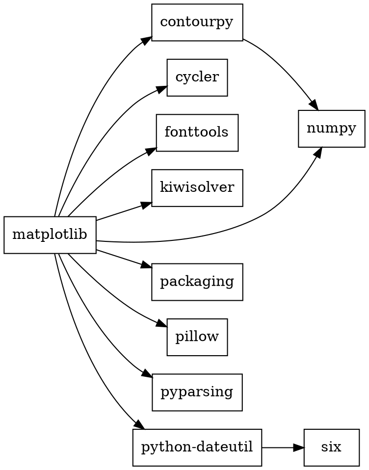
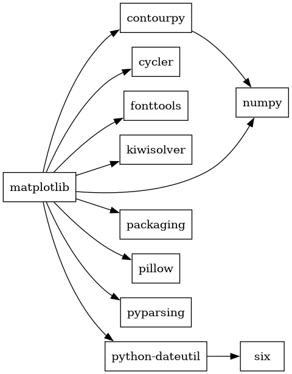
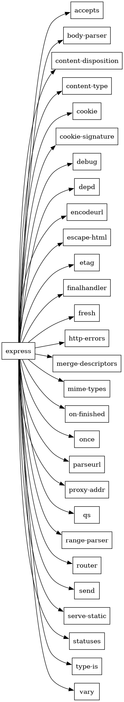

# Практическое занятие №2

Менеджер пакетов ставит программы вместе с зависимостями нужных версий. Пакет = код + файл со служебной информацией (имя, версия, зависимости).

Semver: `MAJOR.MINOR.PATCH`. MAJOR меняется при несовместимых изменениях, MINOR при новых возможностях, PATCH при исправлениях.
- `^1.2.0` = `>=1.2.0 <2.0.0`
- `~1.2.0` = `>=1.2.0 <1.3.0`

Программы со встроенным менеджером пакетов: VS Code (расширения), Python (pip), Node.js (npm), Rust (cargo), Blender и Krita (дополнения), Minecraft-лаунчеры (моды).

## Задача 1

Служебная информация о пакете matplotlib.

```bash
pip install matplotlib
pip show matplotlib
```

```
Name: matplotlib
Version: 3.11.2
Summary: Python plotting package
Author: John D. Hunter, Michael Droettboom
Location: .../site-packages
Requires: contourpy, cycler, fonttools, kiwisolver, numpy, packaging, pillow, pyparsing, python-dateutil
Required-by:
```

Сам файл лежит в `site-packages/matplotlib-3.11.2.dist-info/METADATA`:

```
Metadata-Version: 2.1
Name: matplotlib
Version: 3.11.2
Summary: Python plotting package
Classifier: Programming Language :: Python :: 3
Project-URL: Source Code, https://github.com/matplotlib/matplotlib
Requires-Python: >=3.11
Requires-Dist: contourpy>=1.0.1
Requires-Dist: numpy>=1.25
...
```

- `Name`, `Version` - имя и версия пакета.
- `Summary` - краткое описание.
- `Classifier` - категории для PyPI (лицензия, версии Python, тема).
- `Project-URL` - сайт, исходники, баг-трекер.
- `Requires-Python` - нужная версия Python.
- `Requires-Dist` - зависимости с ограничениями версий.

Без менеджера пакетов, прямо из репозитория:

```bash
git clone https://github.com/matplotlib/matplotlib.git
cd matplotlib
python -m pip install .
```

Или скачать архив `.whl` / `.tar.gz` с https://pypi.org/project/matplotlib/#files (wheel это обычный zip, можно распаковать).

## Задача 2

Служебная информация о пакете express.

```bash
npm view express
npm install express
cat node_modules/express/package.json
```

Основное из `package.json`:

```json
{
  "name": "express",
  "description": "Fast, unopinionated, minimalist web framework",
  "version": "5.2.1",
  "author": "TJ Holowaychuk <tj@vision-media.ca>",
  "license": "MIT",
  "repository": "expressjs/express",
  "dependencies": {
    "accepts": "^2.0.0",
    "body-parser": "^2.2.1",
    "debug": "^4.4.0",
    ...
  },
  "engines": { "node": ">= 18" },
  "files": ["LICENSE", "Readme.md", "index.js", "lib/"],
  "scripts": { "test": "mocha ...", "lint": "eslint ." }
}
```

- `name`, `version`, `description` - имя, версия, описание.
- `author`, `license`, `repository` - автор, лицензия, где исходники.
- `dependencies` - зависимости (версии в semver, `^` = совместимые).
- `devDependencies` - нужны только для разработки (тесты, линтер).
- `engines` - нужная версия Node.js.
- `files` - что попадает в пакет.
- `scripts` - команды для `npm run`.

Без менеджера пакетов:

```bash
git clone https://github.com/expressjs/express.git
```

Или скачать архив пакета напрямую: https://registry.npmjs.org/express/-/express-5.2.1.tgz

## Задача 3

Зависимости смотрим так:

```bash
pip install pipdeptree
pipdeptree -p matplotlib
npm ls express --all
```

По выводу пишем graphviz-код и рисуем: `dot -Tpng matplotlib.dot -o matplotlib.png`.

[matplotlib.dot](matplotlib.dot):





[express.dot](express.dot) - прямые зависимости express (из `dependencies`):



## Задача 4

MiniZinc: https://www.minizinc.org/software.html. Запуск из консоли: `minizinc --solver gecode tickets.mzn`.

Счастливый билет: 6 цифр, сумма первых трёх = сумма последних трёх, все цифры разные. Ищем минимальную сумму трёх цифр.

[tickets.mzn](tickets.mzn):

```minizinc
include "alldifferent.mzn";

array[1..6] of var 0..9: d;

constraint all_different(d);
constraint d[1] + d[2] + d[3] = d[4] + d[5] + d[6];

solve minimize d[1] + d[2] + d[3];
```

```
Билет: 620431
Сумма: 8
```

Меньше 8 нельзя: суммы 3..7 дают слишком мало разных троек цифр, и две тройки без общих цифр не находятся.

## Задача 5

Версии кодируем номерами, 0 = пакет не ставим.

[deps5.mzn](deps5.mzn):

```minizinc
% menu: 1 = 1.0.0 ... 6 = 1.5.0
var 0..6: menu;
% dropdown: 1 = 1.8.0, 2 = 2.0.0 ... 5 = 2.3.0
var 0..5: dropdown;
% icons: 1 = 1.0.0, 2 = 2.0.0
var 0..2: icons;

% root зависит от menu и icons 1.0.0
constraint menu > 0;
constraint icons = 1;

constraint menu >= 2 -> dropdown >= 2;
constraint menu = 1 -> dropdown = 1;
constraint dropdown >= 2 -> icons = 2;

solve maximize menu + dropdown;
```

```
menu = 1, dropdown = 1, icons = 1
```

Ответ: menu 1.0.0, dropdown 1.8.0, icons 1.0.0. Новые menu тянут dropdown 2.x, а тот icons 2.0.0, но root требует icons 1.0.0.

## Задача 6

[deps6.mzn](deps6.mzn):

```minizinc
var 0..2: foo;      % 1 = 1.0.0, 2 = 1.1.0
var 0..1: left;     % 1 = 1.0.0
var 0..1: right;    % 1 = 1.0.0
var 0..2: shared;   % 1 = 1.0.0, 2 = 2.0.0
var 0..2: target;   % 1 = 1.0.0, 2 = 2.0.0

constraint foo >= 1;                               % root -> foo ^1.0.0
constraint target = 2;                             % root -> target ^2.0.0
constraint foo = 2 -> (left = 1 /\ right = 1);     % foo 1.1.0 -> left, right
constraint left = 1 -> shared >= 1;                % left -> shared >=1.0.0
constraint right = 1 -> shared = 1;                % right -> shared <2.0.0
constraint shared = 1 -> target = 1;               % shared 1.0.0 -> target ^1.0.0

solve maximize 10 * foo - left - right - shared;
```

```
foo = 1, left = 0, right = 0, shared = 0, target = 2
```

Ответ: root 1.0.0, foo 1.0.0, target 2.0.0. foo 1.1.0 взять нельзя: через right он требует shared 1.0.0, а тот target 1.0.0, что противоречит target ^2.0.0 у root.

## Задача 7

Общая модель [deps.mzn](deps.mzn), конкретная задача задаётся только данными (`.dzn`). Пакет 1 это root, версии перечислены по возрастанию, версия = номер в списке.

```minizinc
int: n;                                  % число пакетов
array[1..n] of string: names;
int: maxv;
array[1..n, 1..maxv] of string: vers;    % названия версий
array[1..n] of int: nv;                  % сколько версий у пакета

% зависимость k: пакет from_p версии from_v требует to_p версии от lo до hi
int: m;
array[1..m] of int: from_p;
array[1..m] of int: from_v;
array[1..m] of int: to_p;
array[1..m] of int: lo;
array[1..m] of int: hi;

array[1..n] of var 0..maxv: sel;         % выбранная версия, 0 = не ставим

constraint forall(p in 1..n)(sel[p] <= nv[p]);
constraint sel[1] = 1;

constraint forall(k in 1..m)(
    sel[from_p[k]] = from_v[k] -> (sel[to_p[k]] >= lo[k] /\ sel[to_p[k]] <= hi[k])
);

% лишних пакетов не ставим
constraint forall(p in 2..n)(
    sel[p] > 0 -> exists(k in 1..m)(to_p[k] = p /\ sel[from_p[k]] = from_v[k])
);

solve maximize sum(sel);
```

Данные задачи 6, [deps6.dzn](deps6.dzn):

```minizinc
n = 6;
names = ["root", "foo", "left", "right", "shared", "target"];
maxv = 2;
nv = [1, 2, 1, 1, 2, 2];
vers = [| "1.0.0", ""
        | "1.0.0", "1.1.0"
        | "1.0.0", ""
        | "1.0.0", ""
        | "1.0.0", "2.0.0"
        | "1.0.0", "2.0.0" |];
m = 7;
from_p = [1, 1, 2, 2, 3, 4, 5];
from_v = [1, 1, 2, 2, 1, 1, 1];
to_p   = [2, 6, 3, 4, 5, 5, 6];
lo     = [1, 2, 1, 1, 1, 1, 1];
hi     = [2, 2, 1, 1, 2, 1, 1];
```

```
$ minizinc deps.mzn deps5.dzn
root 1.0.0
menu 1.0.0
dropdown 1.8.0
icons 1.0.0

$ minizinc deps.mzn deps6.dzn
root 1.0.0
foo 1.0.0
target 2.0.0
```

Ответы совпали с задачами 5 и 6.
